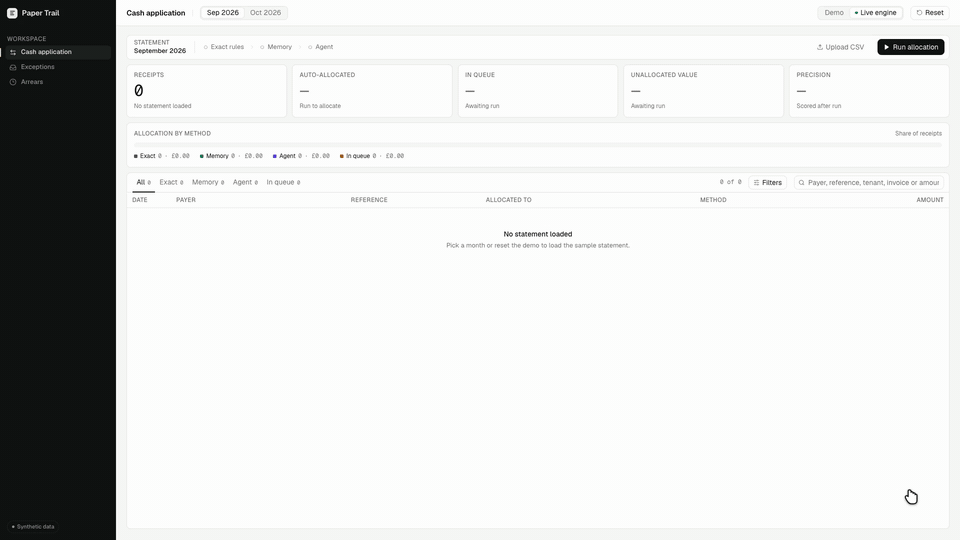
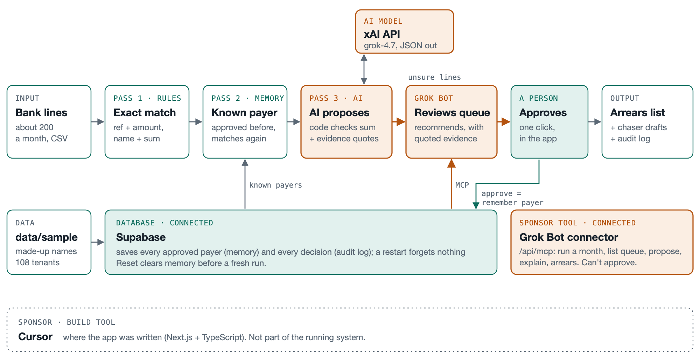

<h1 align="center">🧾 Paper Trail</h1>

<h3 align="center">Every rent receipt on the right charge. Grok Bot reviews the hard ones, a person decides once.</h3>

<p align="center">Cash application for commercial property managers, where a payment that looks wrong is often right.</p>

<p align="center">
  <a href="https://youtu.be/YAJkaIV0UbU"><b>▶ 2-min demo</b></a> ·
  <a href="#results"><b>Results</b></a> ·
  <a href="#judges"><b>For judges</b></a> ·
  <a href="https://paper-trail-smoky.vercel.app/"><b>Live site (demo mode)</b></a> ·
  <a href="docs/grok-bot-credit-controller.md"><b>Grok Bot setup</b></a>
</p>

<p align="center">
  <a href="https://youtu.be/YAJkaIV0UbU"></a>
  <br>
  <sub>▶ Silent preview of the September run. <a href="https://youtu.be/YAJkaIV0UbU"><b>Watch the full video with sound</b></a></sub>
</p>

<p align="center">
  
  
  
  
  
  
</p>

**Grok Bot Real Estate Hackathon London** · 12 Nov 2026 · Track 4: operations and property management · team of four

> **In 30 seconds.** A parent company pays its subsidiary's rent, a tenant holds back disputed service charge, a reference is wrong. Until each receipt is matched, the arrears list is wrong: tenants who paid get chased and real arrears hide. Paper Trail matches **94 to 98%** of receipts on its own with **0 wrong**, sends the rest to a person with quoted evidence and a **Grok Bot** review, and **remembers** each approval, so next month the same payer matches by itself.

| **188 / 200** | **196 / 200** | **196 / 200** | **0 wrong** |
|:---:|:---:|:---:|:---:|
| September, automatic | October, 8 from memory | November hold-out, scored once | across all three months |

<sub>All figures are on our synthetic test set. For context, the median company auto-applies 45% of receipts (APQC, 851 companies, as cited by creditpulse.com).</sub>

> 💡 Every section opens with a one-line answer. Click any ▸ line for the detail.

### Contents

1. [🎯 The problem](#problem)
2. [🧭 How it works](#how)
3. [📊 Results](#results)
4. [⚖️ For judges](#judges)
5. [🎬 Live demo](#demo)
6. [🚀 Setup and test data](#setup)
7. [👥 Team](#team)

## <a name="problem"></a>1. 🎯 The problem

**Until cash is allocated, the arrears list is wrong, and in commercial property the hard receipts need judgement.**

<details>
<summary><b>Why matching takes a person today</b></summary>

<br>

A property manager's arrears list is only as good as the cash allocation behind it. Receipts arrive with wrong or missing references, one transfer covering several invoices, a parent company paying for its tenant, or a short payment because the tenant is disputing part of the service charge. Until someone matches each line by hand against the ledger, the lease and old emails, tenants who paid get chased, and real arrears hide in unallocated cash.

Paper Trail keeps the person for the judgement calls only:

- **Most lines never need a person:** 188 of 200 in September, 196 of 200 in October, 0 wrong.
- **Every allocation shows its evidence,** so a credit controller checks it in seconds instead of redoing it.
- **It learns:** approve a parent-company payer once and next month it matches from memory.
- **It won't guess:** duplicates and unidentifiable payments stay with a person, and a model can't approve anything.

</details>

## <a name="how"></a>2. 🧭 How it works

**Code first, then memory, then Grok. Grok Bot reviews what's left, and a person approves.**



<details>
<summary><b>The passes, the queue and the stack</b></summary>

<br>

1. **Pass 1, code.** Exact reference and amount, then a duplicate guard, then payer name plus a subset sum over that tenant's open charges.
2. **Pass 2, memory.** Payer aliases learned from earlier approvals, kept in Supabase.
3. **Pass 3, Grok.** grok-4.7 proposes a split with evidence; code checks it adds up to the penny and that every quote exists in its source.
4. **Grok Bot review.** A "Credit Controller" bot in the Grok Bot app reviews the lines waiting for a person through our MCP connector and recommends approve, reject or needs info, with quotes. It can't approve.
5. **A person approves.** Approving a new payer creates an alias, so next month the line matches in pass 2.

**Stack:** Next.js (App Router) and TypeScript, Supabase (Postgres) for payer memory and the audit log, the xAI API (grok-4.7) for pass 3, and the Grok Bot MCP connector (`lib/mcp/handler.ts`) for review, explanations and chaser drafts.

</details>

## <a name="results"></a>3. 📊 Results

**94% automatic in September, 98% in October and in the November hold-out, 0 wrong.**

| Month | Lines | Auto-approved | Precision of approved | Wrong | To a person |
|---|---|---|---|---|---|
| 2026-09 (tuning) | 200 | 188 (94%) | 100.0% | 0 | 12 |
| 2026-10 (tuning, from memory) | 200 | 196 (98%) | 100.0% | 0 | 4 |
| 2026-11 (hold-out, scored once) | 200 | 196 (98%) | 100.0% | 0 | 4 |

<details>
<summary><b>How the numbers were produced</b></summary>

<br>

Pass 3 is grok-4.7 on the xAI API, concurrency 20. A payer that isn't the tenant and isn't yet in payer memory always goes to a person, however confident the model is. So in September the 8 parent-company payments wait for approval, alongside 2 duplicates and 2 unidentifiable payers. In October the 8 parent payers, approved in September, match from memory, and the 4 lines to a person are the 2 duplicates and 2 unidentifiable payers. Leaving those 4 open is the right answer.

- `results/2026-09.json` and `results/2026-10.json` are a grok-4.7-only run (108 evidence quotes checked, 0 not found), which the app replays. Reproduce with `PASS3_MODE=grok npx tsx scripts/pass3.ts --save`; an approval is simulated between the months.
- November was scored once with `npx tsx scripts/pass3.ts --holdout`: September and October run first, so November starts with their payer memory. 133 evidence quotes checked, 0 not found; 205 s for the three months.
- An earlier run with Jev (TypeSafe) first, then grok-4.7, gave the same September and October figures in 134 s. With grok-4.20 non-reasoning in place of grok-4.7, 8 allocations were wrong.

</details>

## <a name="judges"></a>4. ⚖️ For judges

**Where to look for each criterion.**

<details>
<summary><b>The criteria, mapped to the code</b></summary>

<br>

| Criterion | What to look at |
|---|---|
| Relevance to a real estate problem | Until cash is allocated, the arrears list is wrong. The test data has the cases that need judgement every month: 8 parent-company payers, 5 combined payments, 5 short payments with service charge withheld, 3 overpayments, 2 duplicates, 2 unidentifiable (`data/sample/`). |
| Quality of execution | `npm test` (vitest). Money is integer pence inside the engine (`lib/cash/money.ts`); a proposal a penny out is refused (`lib/cash/checkSum.ts`). |
| Effective use of Grok Bot | Grok Bot connects through our MCP connector (`lib/mcp/handler.ts`) with 9 tools: `run_month`, `summary`, `list_exceptions`, `list_review_queue`, `review_line`, `propose_allocation`, `explain_line`, `arrears`, `draft_chasers`. It reviews the lines waiting for a person and recommends with quotes; it can't approve. Setup: `docs/grok-bot-credit-controller.md`. |
| Effective use of Cursor | The code was AI-generated under our direction in Cursor, which also reads our Supabase tables through its Supabase connector. |
| Traceable data | Every allocation carries evidence quotes (bank line, charge, lease, company lookup, tenant note) and every quote is checked against its source, so a made-up quote sends the line to a person. Every decision is in the audit log with who made it (`human`, `grok_bot`, `system`). |
| Practical usefulness | An arrears list a manager can act on, chaser drafts that hold back disputed amounts, and payer memory in Supabase, so next month's parent-company payments match without anyone. |

</details>

## <a name="demo"></a>5. 🎬 Live demo

**About 90 seconds: run September, approve the parent payers, run October.**

**Live site: <https://paper-trail-smoky.vercel.app/> runs in demo mode only.** It plays back a recorded run instantly. A live engine run takes about 80 seconds and the screen gives no progress feedback yet, so run the live engine locally: `npm run dev`, then open `http://localhost:3000/?mode=live`. The figures in Results come from the engine run saved in `results/`.

<details>
<summary><b>The demo script</b></summary>

<br>

Reset first (`POST /api/reset`), so September isn't already loaded.

| Step | In the app | Say |
|---|---|---|
| 1 | Run September | "200 bank lines. 188 matched automatically, 0 wrong. 12 need me." |
| 2 | Review 12, open a parent payer (e.g. PREMIER GROUP PLC) | "A group company pays for its tenant. It's a new payer, so a person approves it the first time. Grok Bot has reviewed it." |
| 3 | Approve. The toast reads "Remembered: PREMIER GROUP PLC pays for ..." | "Now it remembers." |
| 4 | Approve the other parent payers: 8 lines from 4 groups | |
| 5 | Show the 4 left: 2 duplicates, 2 unidentifiable | "These you should always look at yourself. No guess." |
| 6 | Run October | "196 matched, 8 of them from memory. 4 need me, and those are the right 4." |
| 7 | | "We held out November and scored it once at the end: 98%, 0 wrong." |

Approve all 8 before you run October; lines you didn't approve don't go into memory.

</details>

## <a name="setup"></a>6. 🚀 Setup and test data

**A Supabase project, two env vars, one schema file and the public sample.**

<details>
<summary><b>Run it</b></summary>

<br>

Put `SUPABASE_URL` and `SUPABASE_SERVICE_ROLE_KEY` in `.env` (git-ignored; never commit it). Run `supabase/schema.sql` in the Supabase SQL editor, then load the public sample:

```
python3 data/load_supabase.py --dir data/sample --with-bank
npm install && npm run dev
```

Re-running the loader is safe: rows are upserted on their primary key. To connect Grok Bot, follow `docs/grok-bot-credit-controller.md`.

</details>

<details>
<summary><b>The test data</b></summary>

<br>

`data/sample/` is committed and safe to share: fully made-up company names.

```
python3 data/generate.py --cortile none --out data/sample
python3 data/check_seed.py --seed-dir data/sample   # 78 checks
```

| File | What's in it |
|---|---|
| `tenants.json` | 108 tenants, each with a unit and a synthetic lease |
| `charges.json` | 432 rent and service charges, Sep and Oct 2026 |
| `bank_2026_09.csv`, `bank_2026_10.csv` | 200 bank lines each, with the answer key in `true_allocations` and `true_unallocated` |
| `tenant_notes.json` | Dispute history, e.g. service charge withheld over a broken lift |
| `company_lookup.json` | Stub lookup of parent companies paying for a tenant |
| `holdout/` | November: charges, 200 bank lines, notes. Don't tune on it |

| Case each month | Lines | Settled by |
|---|---|---|
| clean | 170 | Pass 1 |
| bad_reference | 5 | Pass 1 (name and sum) |
| combined | 5 | Pass 1 (name and sum) |
| duplicate | 2 | Duplicate guard |
| parent_payer | 8 | Agent, then a person once |
| short_pay | 5 | Agent |
| overpayment | 3 | Agent |
| unidentifiable | 2 | Agent, left for a person |

**Cortile data stays local.** The generator can also build on Cortile's synthetic portfolio if you've claimed it in the event Discord. That output goes to `data/seed/` and the Cortile files to `data/private/`, both git-ignored, because the licence is for this event only.

</details>

## <a name="team"></a>7. 👥 Team

Two builders (matching engine and agent; app, database, memory and the Grok Bot connector), a finance lead (domain checks, chaser wording, time saved) and a data and demo lead. Code is AI-generated under our direction, using Cursor.
